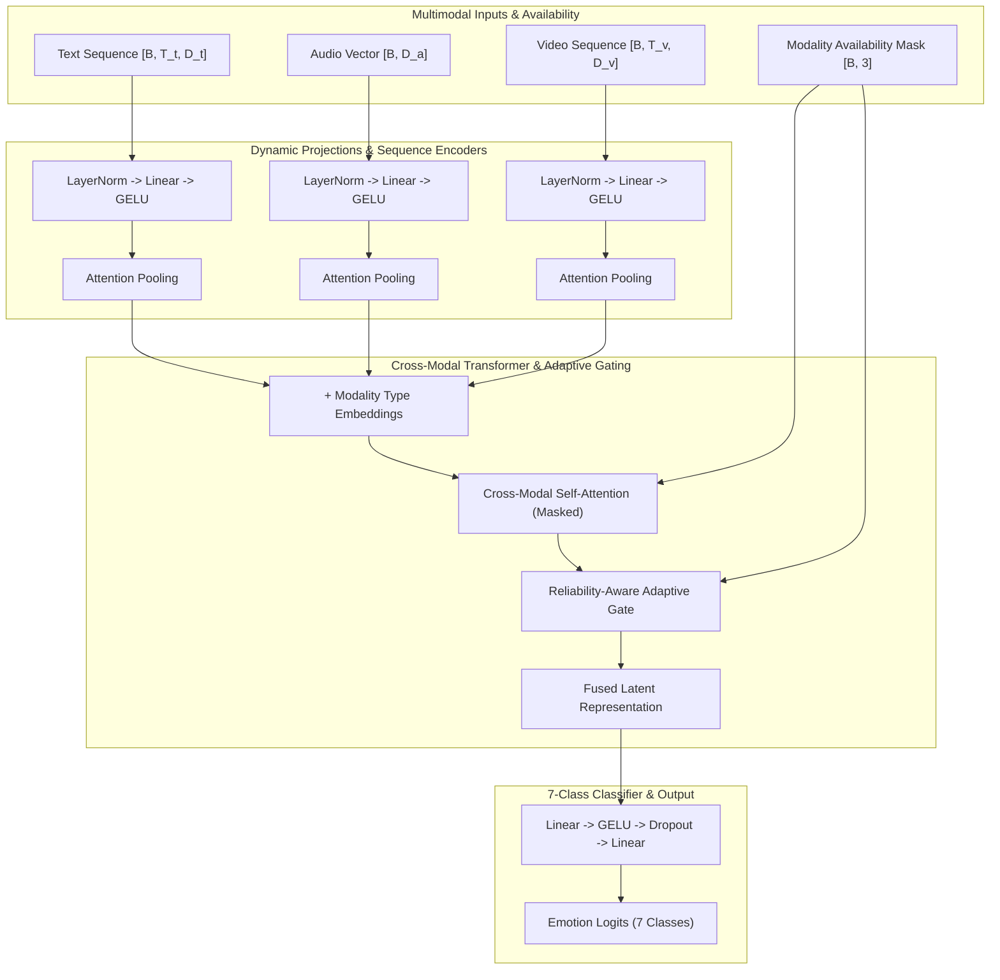

# NeuroSense-Net: Reliability-Aware Multimodal Emotion Recognition

[](https://pytorch.org/)
[](https://opensource.org/licenses/MIT)
[](https://www.python.org/)

**NeuroSense-Net** is a research-grade, reproducible deep learning framework for multimodal utterance-level emotion recognition from the **MELD** (Multimodal EmotionLines Dataset) benchmark. It dynamically fuses **Text**, **Audio**, and **Video** representations using a reliability-aware adaptive gating mechanism and transformer cross-modal self-attention.

> **Scientific Honesty & Disclaimer**: NeuroSense-Net is a *SOTA-oriented research prototype*. Performance claims on real benchmark data require empirical verification on exact MELD data splits. Gate weights reflect model feature allocation confidence under given inputs, not causal psychological evidence.

---

## 1. Architecture Overview



---

## 2. Key Features

- **Schema-Agnostic Dataset Discovery**: Automatic discovery and dynamic shape inference for `.pt`, `.pth`, `.npz`, `.csv` preprocessed MELD formats.
- **Reliability-Aware Adaptive Gating**: Per-sample softmax gate weights ($\sum_{m \in \text{avail}} w_m = 1.0$) with zero allocation to missing modalities.
- **Missing Modality Robustness**: Full ablation protocol evaluating model performance under missing text, audio, or video.
- **Multiclass Focal Loss**: Stable log-softmax Focal Loss ($\gamma = 2.0$) with training-set effective number class weighting.
- **Modality Dropout**: Randomly drops active modalities during training ($p = 0.10$) to enforce balanced multimodal reliance.
- **Self-Contained Kaggle Notebook**: Fully runnable on Kaggle GPU with synthetic dataset fallback.

---

## 3. Target Classes (MELD 7 Emotions)

```text
0: neutral,  1: joy,  2: surprise,  3: sadness,  4: anger,  5: disgust,  6: fear
```

---

## 4. Repository Structure

```text
NeuroSense-Net/
├── README.md                            # Comprehensive documentation
├── requirements.txt                     # Core dependencies
├── pyproject.toml                       # Build & pytest config
├── .gitignore
├── configs/                             # YAML hyperparameter configs
│   ├── default.yaml
│   ├── smoke_test.yaml
│   └── kaggle.yaml
├── src/                                 # Modular framework source code
│   ├── __init__.py
│   ├── utils.py                         # Seeding, logging, I/O
│   ├── config.py                        # Dataclasses & validators
│   ├── losses.py                        # Focal Loss & class weighting
│   ├── metrics.py                       # Sklearn metrics calculator
│   ├── visualization.py                 # Publication PNG plotting
│   ├── engine.py                        # Trainer, Evaluator, Ablation
│   ├── data/
│   │   ├── __init__.py
│   │   ├── dataset.py                   # MELDDataset & SyntheticMELDDataset
│   │   ├── collate.py                   # Dynamic multimodal collate
│   │   └── inspection.py                # DatasetInspector report generator
│   └── models/
│       ├── __init__.py
│       ├── layers.py                    # Modality projections & sequence encoders
│       ├── fusion.py                    # Cross-modal attention & adaptive gate
│       └── neurosense_net.py            # NeuroSenseNet model API
├── scripts/                             # Executable CLI scripts
│   ├── inspect_dataset.py
│   ├── train.py
│   ├── evaluate.py
│   ├── predict.py
│   └── smoke_test.py
├── tests/                               # Automated PyTest suite
│   ├── test_dataset.py
│   ├── test_model.py
│   ├── test_loss.py
│   └── test_smoke_pipeline.py
└── notebooks/
    └── Kaggle_NeuroSense_Net_Train.ipynb # Self-contained Kaggle notebook
```

---

## 5. Quick Start & Installation

### Environment Setup

```bash
git clone https://github.com/your-username/NeuroSense-Net.git
cd NeuroSense-Net
pip install -r requirements.txt
```

### 1. Run Automated Smoke Test (Synthetic Data)

Run the fast 3-epoch synthetic smoke test to verify all pipeline components, checkpoints, and plot generation:

```bash
python scripts/smoke_test.py --epochs 3 --use-synthetic
```

### 2. Inspect Dataset (Real MELD Data)

Scan input directory for MELD preprocessed tensors and generate dataset diagnostic reports:

```bash
python scripts/inspect_dataset.py --data-root /path/to/meld/data --output-dir outputs/dataset_inspection
```

### 3. Train Model

Train NeuroSense-Net on real or synthetic data:

```bash
# Synthetic Mode (Offline / Debug)
python scripts/train.py --config configs/default.yaml --use-synthetic --epochs 10

# Real Data Mode
python scripts/train.py --config configs/default.yaml --data-root /path/to/meld/data
```

### 4. Evaluate Saved Checkpoint

Run test evaluation and full modality ablation protocol on a saved checkpoint:

```bash
python scripts/evaluate.py --checkpoint outputs/NeuroSense-Net_RUN_ID/checkpoints/best.pt --use-synthetic --split test
```

### 5. Run Inference / Predictions

Generate predictions CSV with predicted class probabilities and adaptive gate weights:

```bash
python scripts/predict.py --checkpoint outputs/NeuroSense-Net_RUN_ID/checkpoints/best.pt --use-synthetic --output predictions.csv
```

---

## 6. Run Artifacts Output Tree

Each training run produces a timestamped artifact directory:

```text
outputs/<run_name>_<timestamp>/
├── config_resolved.yaml                 # Fully resolved configuration
├── environment.json                     # Python, PyTorch, CUDA, Git metadata
├── dataset_report.json                  # Inferred feature dimensions & file layout
├── train.log                            # Console & file execution logs
├── history.csv                          # Epoch loss, macro-F1, accuracy history
├── metrics.json                         # Test performance metrics
├── label_mapping.json                   # Class string-to-int mapping
├── modality_ablation.json               # Robustness ablation results
├── checkpoints/
│   ├── best.pt                          # Model with highest Val Macro-F1
│   └── last.pt                          # Final epoch checkpoint
├── predictions/
│   ├── predictions.csv                  # Test set predictions & gate weights
│   └── error_analysis.csv               # Top confident misclassifications
└── plots/
    ├── training_curves.png              # Train/Val loss, Macro-F1, LR schedule
    ├── confusion_matrix_counts.png
    ├── confusion_matrix_normalized.png
    ├── per_class_f1.png                 # F1 score per class with support
    ├── gate_weights_overall.png         # Mean gate weights & std
    ├── gate_weights_by_true_class.png   # Gate weight breakdown by emotion
    ├── class_distribution.png           # Split class distributions
    └── modality_ablation_macro_f1.png   # Macro-F1 across ablated conditions
```

---

## 7. Metrics & Macro-F1 Priority

Because the MELD dataset exhibits heavy class imbalance (e.g. `neutral` represents ~47% of samples while `disgust` represents ~4%), **Macro-F1** is enforced as the primary selection and early-stopping metric:

$$\text{Macro-F1} = \frac{1}{C} \sum_{c=1}^{C} \text{F1}_c$$

Overall Accuracy alone can be misleading on imbalanced data.

---

## 8. Modality Gating Interpretation Caveat

The adaptive gating module computes sample-wise non-negative weights $w_{\text{text}}, w_{\text{audio}}, w_{\text{video}}$ summing to 1.0 across available modalities.

> **Caution**: High gate weight assigned to a modality indicates that the model relies heavily on that feature representation for its prediction confidence. It does **not** constitute causal psychological proof that the modality carried the true emotion ground truth.

---

## 9. Troubleshooting & FAQ

- **Dataset Not Found**: Run `python scripts/inspect_dataset.py --data-root <path>` to diagnose layout.
- **CUDA OOM**: Reduce `batch_size` in `configs/default.yaml` or enable `mixed_precision: true`.
- **Unknown Tensor Keys**: Pass key overrides via CLI (e.g. `--key-text text_emb --key-audio wav2vec`).

---

## 10. Ethical Limitations & Bias Statement

Emotion recognition models trained on conversational datasets (such as TV show dialogues in MELD) reflect cultural, linguistic, and demographic biases present in the source media. Facial expressions and vocal acoustics vary significantly across cultural backgrounds, contexts, and individuals. Automated emotion classifiers should **never** be used for automated hiring, surveillance, law enforcement, or high-stakes decision making.

---

## 11. License

Distributed under the MIT License. See `LICENSE` for details.
